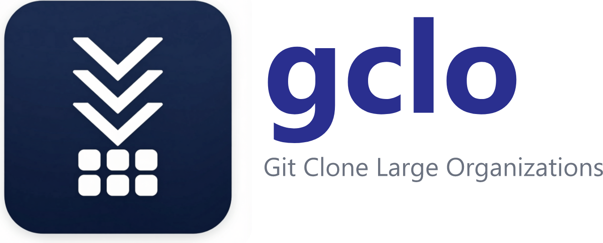
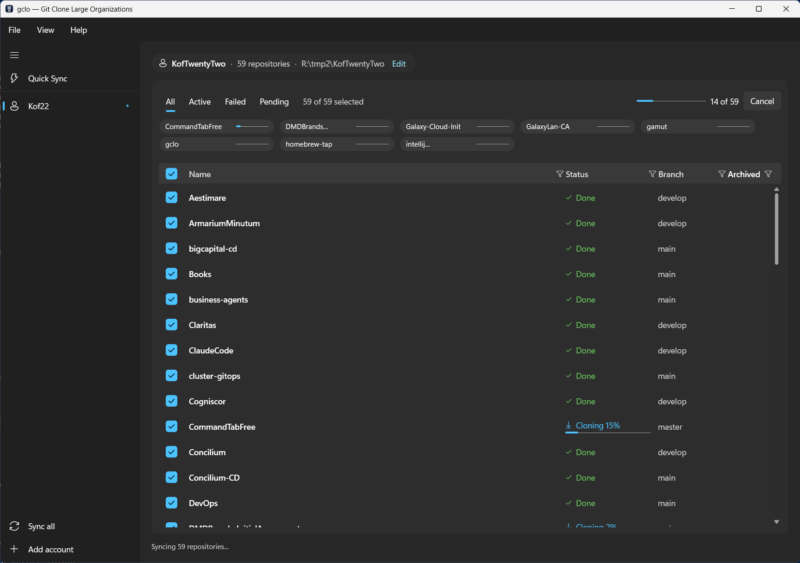
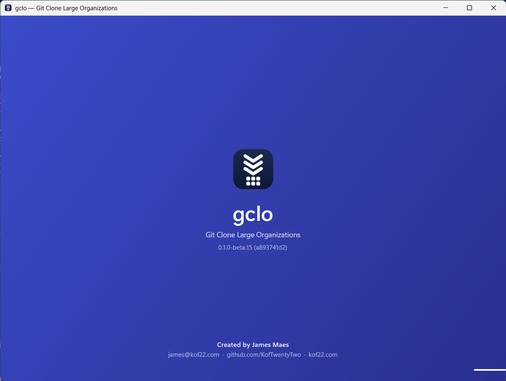
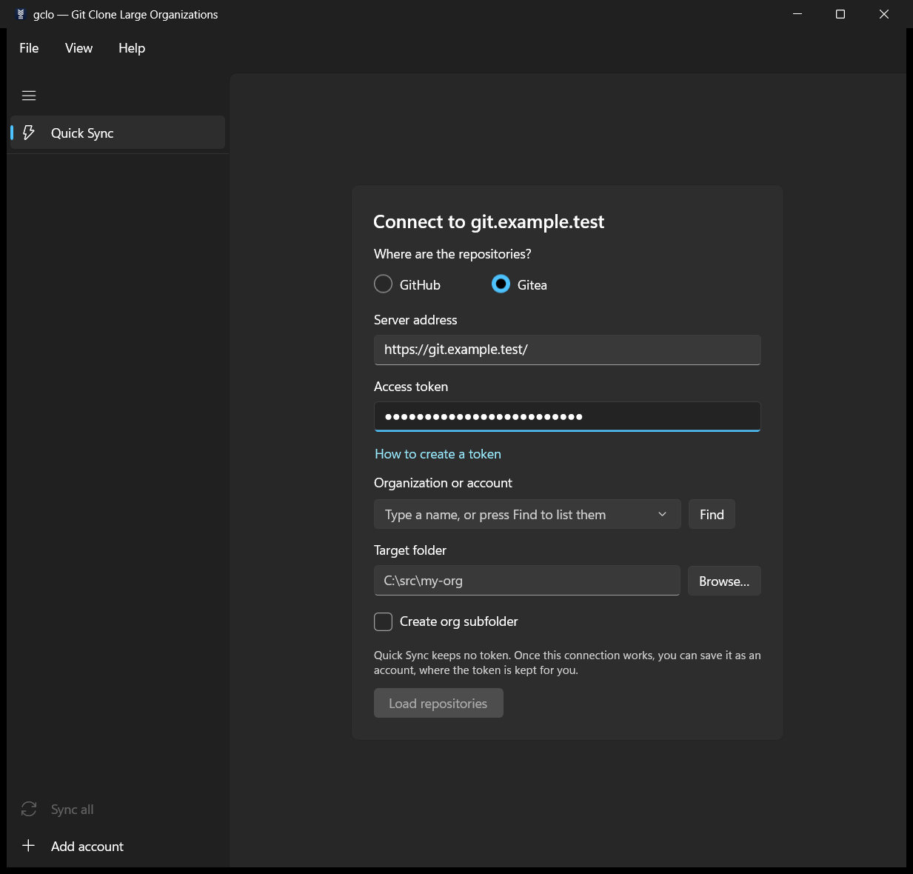
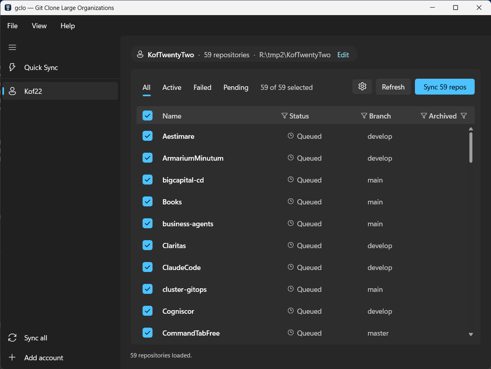
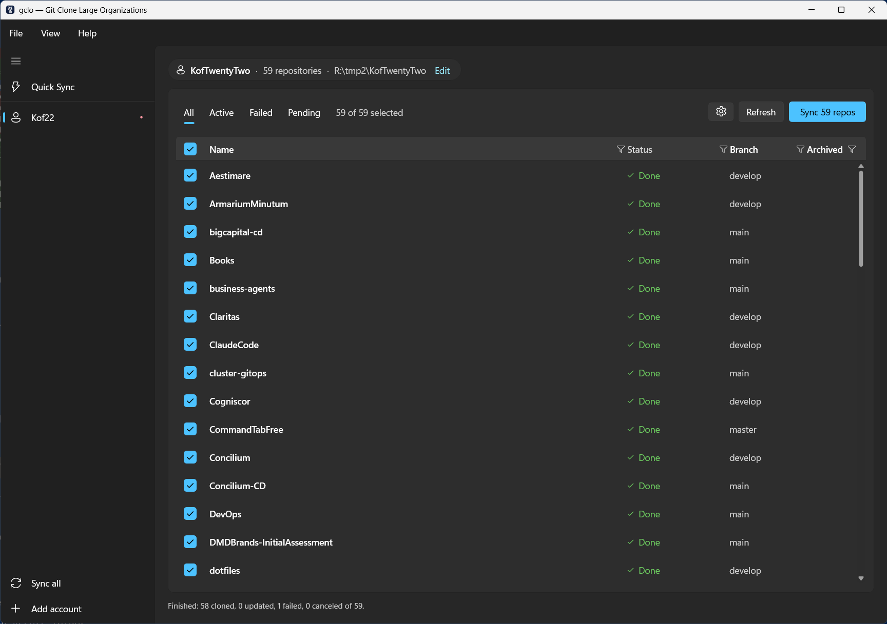
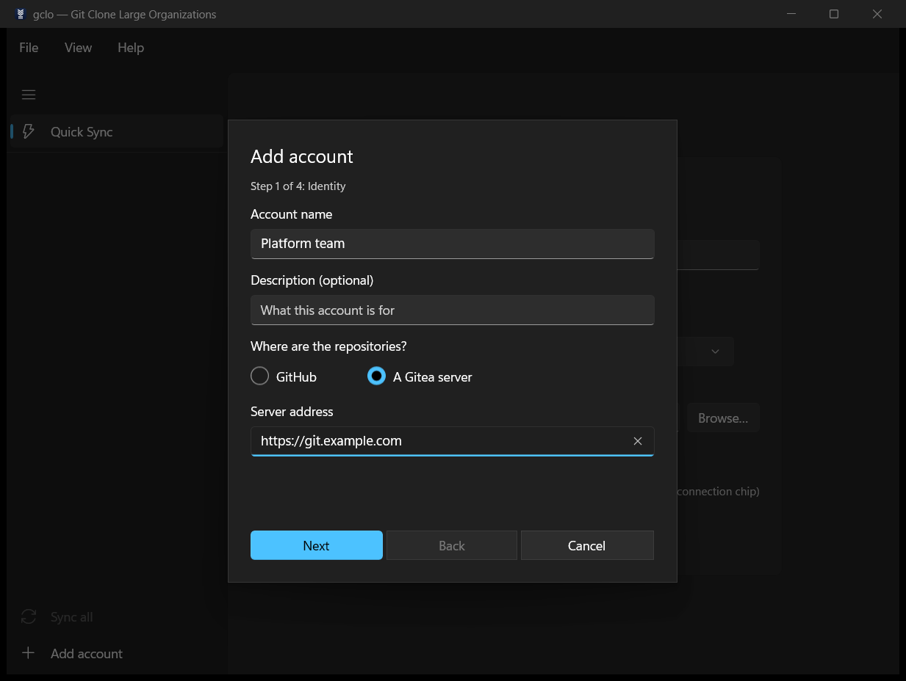

<p align="center">
  
</p>

<p align="center"><b>Clone an entire GitHub or Gitea organization. Keep it up to date. In parallel.</b></p>

<p align="center">
  <a href="https://scorecard.dev/viewer/?uri=github.com/KofTwentyTwo/gclo"></a>
  <a href="LICENSE"></a>
  <a href="https://git.kof22.com/KofTwentyTwo/gclo"></a>
  <a href="https://dotnet.microsoft.com/"></a>
</p>

| | |
| --- | --- |
| **Tier** | Product (see the [KofTwentyTwo standards scope](https://github.com/KofTwentyTwo/standards/blob/main/policies/README.md#scope)) |
| **Standards** | Conforms to [KofTwentyTwo standards](https://github.com/KofTwentyTwo/standards) `main@855cf44` (pre-1.0 draft); conformance tracked in [#62](https://git.kof22.com/KofTwentyTwo/gclo/issues/62) |
| **Latest release** | [Releases](https://git.kof22.com/KofTwentyTwo/gclo/releases/latest) |

**gclo** (**G**it **C**lone **L**arge **O**rganizations) mirrors every repository of a GitHub organization or user account, or of one on a Gitea server, into a local folder in one pass: it clones the repositories that are missing and fast-forwards the ones that already exist, with live per-repo progress and bounded parallelism. It ships as a Windows 11 desktop app (WinUI 3) and a scriptable CLI built on the same engine.

<p align="center">
  
</p>

## Download & install

All builds are published on the project's [**Releases** page](https://git.kof22.com/KofTwentyTwo/gclo/releases).

**Desktop app (GUI)** — download and run `gclo-stable-Setup.exe`. It installs per-user (no admin rights needed) and updates itself in-app via **Help > Check for updates**. A portable build (`gclo-stable-Portable.zip`) is also attached to each release; portable builds do not self-update.

**CLI** — download `gclo-cli-win-x64-<version>.zip` and unzip it anywhere. It is a self-contained single `gclo.exe` — no .NET runtime required.

Plain version tags (`v1.2.3`) are **stable** releases; pre-release tags (`v1.2.3-beta.1`) publish to the **dev** channel, and an installed app only ever updates within its own channel.

> **Upgrading from a beta?** Channels don't cross: a dev/beta install never auto-updates to a stable release (its **Check for updates** only looks at the dev channel). The beta is a separate app, **gclo (dev)**, with its own accounts and settings. To move to stable, install `gclo-stable-Setup.exe` beside it, add your accounts again, then uninstall the beta; the stable app updates itself within the stable channel from then on.

**Package managers (CLI):**

```powershell
# Scoop: this repository is its own bucket
scoop bucket add gclo https://git.kof22.com/KofTwentyTwo/gclo
scoop install gclo

```

**Chocolatey is not available yet.** The only version submitted, 1.0.1, is still in community moderation with the status "Waiting for Maintainer to take corrective action", so `choco install gclo` does not find it. 1.1.0 has not been submitted. `winget` support for the desktop app is not available either. Both are tracked in [#7](https://git.kof22.com/KofTwentyTwo/gclo/issues/7), and this section will be updated when a package is approved.

The channels available today (the project's Releases page, the in-app updater and Scoop) are all served over HTTPS from git.kof22.com.

## Verifying a release

Every release asset is listed in `SHA256SUMS`, carries a build-provenance attestation, and ships with a CycloneDX SBOM (`gclo-<version>.cdx.json` for the app, `gclo-cli-<version>.cdx.json` for the CLI). Releases are built by the [KofTwentyTwo standards' shared release workflow](https://github.com/KofTwentyTwo/standards/blob/main/.github/workflows/release-velopack.yml), so the provenance names that workflow as the builder:

```powershell
# 1. Integrity: the file matches the published checksum
(Get-FileHash .\gclo-stable-Setup.exe -Algorithm SHA256).Hash   # compare with the line in SHA256SUMS
sha256sum --check --ignore-missing SHA256SUMS                   # Linux / macOS

# 2. Origin: built from this repository's tagged commit by the shared release workflow
gh attestation verify .\gclo-stable-Setup.exe --repo KofTwentyTwo/gclo --signer-repo KofTwentyTwo/standards

# 3. Dependencies: the SBOM is attested too
gh attestation verify .\gclo-cli-win-x64-<version>.zip --repo KofTwentyTwo/gclo --signer-repo KofTwentyTwo/standards --predicate-type https://cyclonedx.org/bom

# 4. Publisher: Setup.exe and every gclo executable are Authenticode-signed (Azure
#    Artifact Signing, SHA-256, RFC 3161 timestamp) by KofTwentyTwo
signtool verify /pa /all /v .\gclo-stable-Setup.exe
Get-AuthenticodeSignature .\gclo-stable-Setup.exe | Format-List Status, SignerCertificate, TimeStamperCertificate
```

Windows checks step 4 for you: a signed installer carries the publisher name in the
SmartScreen and UAC prompts instead of "Unknown publisher".

## Getting a token

gclo authenticates to GitHub with a personal access token — it is used for both the API (listing repositories) and the git transport (cloning and fetching). Create one under [GitHub Settings > Developer settings > Personal access tokens](https://github.com/settings/tokens).

| Token type | What you need |
| --- | --- |
| Classic PAT | `repo` scope (read access to the org's repositories); optionally `read:org` so the organization dropdown / `gclo orgs` can list your orgs |
| Fine-grained PAT | Repository read access for the organization |

**Token storage.** In **Quick Sync**, the token is held in memory for the session only and never written anywhere. A **saved account's** token and the optional **default tokens** (File > Settings: one for GitHub, and one for a Gitea server together with its address) are kept in the **Windows Credential Manager** (per-user, DPAPI-protected) — never in `settings.json`, `accounts.json`, or any log. See [SECURITY.md](SECURITY.md). A saved token is read at the moment it is used: replacing or removing the default token in Settings, or an account's token in its wizard, takes effect for the workspaces that are already open, without a restart. Quick Sync follows a changed default token only while its token box still holds the one Settings put there.

## Using the GUI

On launch, gclo shows a brief branded splash and then opens where you left off: the workspace that was open last, or your first account, or, when there is no account yet, the **Quick Sync** connect card:

<p align="center">
  
  &nbsp;&nbsp;
  
</p>

1. **Choose where the repositories are:** **GitHub** or **Gitea**. For Gitea, enter the address of the server (HTTPS only; a Forgejo server works the same way). On a first run nothing is chosen for you, and the token box takes a token only once you chose. Later the card opens the way the last connection that worked left it: place, server address, organization and target folder. A token is never kept by Quick Sync.
2. **Enter your token.** Nothing is sent yet. Press **Find** beside **Organization or account** to list everything the token can sync: your personal account first, then your organizations alphabetically. That, and **Load repositories**, are the moments a token leaves your machine, and it goes to the place chosen on the card and nowhere else. If the token cannot list organizations (on GitHub a fine-grained PAT, or a classic PAT without `read:org`; on Gitea a token without `read:organization`), the status line says so; the box is editable, so just type the name.
3. **Pick the organization or account** from the dropdown.
4. **Choose a target folder** — type a path or click **Browse...**. Tick **Create a `<org>` subfolder** to keep several organizations under one root; the live preview line underneath always shows exactly where repositories will land (e.g. `C:\src\acme\my-repo`).
5. **Press Load repositories.** The table fills with every repository of the organization — name, status, default branch, and an Archived marker — all selected. Click a column header to sort by it (click again to flip, a third time to return to the default order); use the funnel on any column to filter by name, status, branch, or archived state.

   <p align="center">
     
   </p>

6. **Uncheck anything you don't want.** The header checkbox selects or clears every row at once.
7. **Set parallelism** if you like: the gear button (**Sync options**) in the toolbar has **Parallel clones** (1–64, default 8), how many git operations run at once.
8. **Press Sync** (the button names how many repositories are selected: **Sync 45 repos**). Each row moves through its states live — Queued, Cloning (with a per-row progress bar and transfer percentage), Pulling, Done, Failed, or Canceled — while the overall progress bar and completed/total counter track the run, which ends in a summary (`Finished: 3 cloned, 41 updated, 1 failed, 0 canceled of 45.`). By default the table follows the sync, so what is happening is always in view: repositories in progress are on top, then the failed ones, then the finished ones with the latest first, then the ones still waiting. When the sync is over, the failed ones come first and the rest are in name order. A column you sorted by yourself stays as you set it.

   <p align="center">
     
   </p>

9. **Cancel** at any time: in-flight repos stop cleanly, unstarted repos are marked Canceled, and the summary still appears. After a run, the result bar offers **Retry failed** when something failed (it re-runs exactly the failed rows and leaves your selection alone), otherwise **Open folder**. The folder button in the toolbar opens the target folder in Explorer whenever no sync is running.

**When something goes wrong:** failures are isolated per repository — one broken repo never stops the rest, and a failed row shows its error message inline. Failed clones are cleaned up, and a clone whose checkout never finished (a crash, a kill, a cleanup that could not delete the folder) is flagged inside its `.git`, so a partial working tree is never mistaken for an up-to-date repo on the next run — gclo completes the checkout instead. What it completes is its own. On Windows, a file that is already where the repository has one is replaced only when it is what the unfinished checkout wrote there (its content, or the beginning of it, line endings aside); for anything else the row fails and names the file: move it and sync again. The same check guards a repository that was empty when it was cloned and gets its first files later. Such a clone follows the origin's default branch when nothing has been put into its folder (otherwise it keeps the branch its HEAD names, and stays empty until origin has that branch); a clone that has branches of its own is left as it is when its HEAD names a branch without commits (a branch you started there yourself). If you have worked in an unfinished clone with git in the meantime, gclo finishes it only when every file there is still the repository's own and nothing you added with `git add` would be removed; otherwise the row fails and names the file. While a canceled clone or update is still ending, syncing that repository again fails with a message to try again when it has finished. Repositories with Windows-impossible paths are the deliberate exception: gclo checks every path in the incoming tree against Windows file-system rules *before* checkout — invalid characters, reserved device names like `CON`, trailing spaces or dots, names that differ only by case — and when it finds any, the repo is marked Failed with a per-path list of reasons, but the fully fetched `.git` is **kept** (nothing was ever checked out). Recovery happens in place, with no re-download: click the row's **Resolve…** link to rename each offending path (safe names are pre-suggested) or skip it, and gclo materializes the working tree right there; the CLI does the same automatically with [`--sanitize-paths`](docs/CLI.md#windows-invalid-paths-and---sanitize-paths). This applies to a repository gclo could not check out when it cloned it. A repository that was already checked out normally is never rewritten: when an update brings it such a path, it fails and nothing in it is changed, and **Resolve…** (or `--sanitize-paths`) then says how to get a fresh clone with the renames instead of touching it. When WSL is installed with git in its default distribution, the same dialog offers **Clone in WSL instead**: the repository is cloned unchanged into `~/gclo/<org>/<repo>` inside WSL (reachable from Explorer as `\wsl.localhost\<distro>\home\...`), the token travels only through the environment, and the Windows copy is left as it is. Long paths beyond the classic 260-character limit are handled automatically (`core.longpaths`).

**Settings** (File > Settings…) let you set a default GitHub token (stored in the Windows Credential Manager), the default target folder (with a folder picker), the default parallelism, and the theme (System, Light, or Dark); an Advanced section toggles the startup splash and its duration.

**Activity log:** View > Activity log… shows the tail of today's log and links to the logs folder. Logs live under `%LOCALAPPDATA%\KofTwentyTwo\gclo\logs`, one file per day, kept for 30 days; they record run parameters, per-repo failures, and when the window stopped responding (for how long, and what was running), and never contain your token (see [SECURITY.md](SECURITY.md)).

**Share:** Help > Share gclo by email… opens a new message in your email program with an invitation already written: what gclo is, where to download the latest release, and how to install it. Type an address and send; gclo itself sends nothing. If no email program is set up, the text is shown and copied to the clipboard, to paste into a message by hand.

**Updates:** Help > Check for updates… downloads and applies the latest release for your channel from the project's releases on git.kof22.com. Versions up to 1.1.0 look for updates on GitHub; if they do not find 1.1.1 there, install it once by hand, and it updates itself from then on. Self-update is only available in installed builds (not the portable zip or a local debug build).

### Saved accounts

Quick Sync is ad-hoc — no token is saved. Once a connection has loaded its repositories, a bar above the table offers **Save as account…**. For organizations you sync regularly, **Add account** stores a reusable profile: a name, where the repositories are, the organization, target folder, and parallelism, with the token kept in the Windows Credential Manager (never in a file). The first step asks where the repositories are: **GitHub** or **Gitea**, and for Gitea the address of the server (HTTPS only; a Forgejo server works the same way). The token of the next step is checked with that place and sent nowhere else, and an account stays on the place it was added for: to move one, delete it and add it again. Each account gets its own entry in the navigation pane and its own workspace; **Sync all** runs every saved account in turn. A status bar above the workspace is there for the whole pass, whichever workspace is on screen: it says which account is syncing, which of how many, and how far along it is, takes you to that account, and holds the result when the pass is over. The pane shows each account's live status as well. **Cancel sync all** stops the pass after the account that is syncing, and the result says how many accounts were not started. An account that could not be synced (it has no token, or its repositories could not be loaded) is marked in the pane and counted as needing attention, so a pass in which it was left out does not read as a success. An account's token is changed with **Edit account…** on the account's page (**Edit…** in the pane's menu); the token box on an account's page takes no input. Sync all syncs the repositories each account's page lists: **Refresh** on that page picks up repositories created since it was loaded.

<p align="center">
  
</p>

## Using the CLI

The CLI drives the same engine from scripts and scheduled jobs. There is deliberately no `--token <value>` option — command-line arguments leak to other processes — so the token comes from the `GITHUB_TOKEN` environment variable by default, or from `--token-env`, `--token-file`, or `--token-stdin`.

PowerShell:

```powershell
# List everything the token can sync (your account first, then orgs)
$env:GITHUB_TOKEN = (Get-Secret -Name GitHubPat -AsPlainText)
gclo orgs

# Mirror an organization, 16 git operations at a time
gclo sync --org contoso --target C:\src\contoso --parallel 16

# Preview, then sync a subset (globs on the repository name; archived ones skipped)
gclo repos --org contoso --include "platform-*" --skip-archived
gclo sync --org contoso --target C:\src\contoso --include "platform-*" --skip-archived --dry-run

# Save the connection as an account (token in Windows Credential Manager) and reuse it
gh auth token | gclo accounts add --name work --org contoso --target C:\src\contoso --token-stdin
gclo sync --account work

# Pipe the token from a secret store — it never touches a command line or disk
gh auth token | gclo sync --org contoso --target C:\src\contoso --token-stdin

# Machine-readable result
$result = gclo sync --org contoso --target C:\src\contoso --json | ConvertFrom-Json
if ($result.failed -gt 0) { $result.failures | ForEach-Object { "$($_.repo): $($_.error)" } }
```

bash:

```bash
# List orgs, then mirror one
export GITHUB_TOKEN="$(pass show github/pat)"
gclo orgs
gclo sync --org contoso --target ~/src/contoso

# Pipe the token from a secret store
op read "op://Private/GitHub PAT/token" | gclo sync --org contoso --target ~/src/contoso --token-stdin

# Machine-readable result with jq
gclo sync --org contoso --target ~/src/contoso --json |
  jq -r '.failures[] | "\(.repo): \(.error)"'
```

`--org` accepts an organization or a user account login. `--json` suppresses progress output and prints a single JSON summary line; combined with the exit code it makes gclo easy to wire into cron/scheduled tasks:

| Exit code | Meaning |
| --- | --- |
| 0 | Everything succeeded. |
| 1 | The run completed, but some repositories failed or the run was canceled (Ctrl+C). |
| 2 | Fatal: bad arguments, missing or empty token, or organization not found. |
| 3 | GitHub (or the Gitea server) rejected the token or refused it access: fix the token, do not retry as is. |
| 4 | A rate limit, a network failure, a timeout, or an error on the server's side: retry later. |
| 70 | An unexpected error inside gclo; details are in the activity log. |

**A Gitea server instead of GitHub** (also Forgejo, which speaks the same API): name the server with `--server`. The token comes from `GITEA_TOKEN` then, never from `GITHUB_TOKEN`, and it is sent to that server only (HTTPS; redirects are not followed).

```powershell
$env:GITEA_TOKEN = (Get-Secret -Name GiteaToken -AsPlainText)
gclo orgs --server https://git.example.com
gclo sync --server https://git.example.com --org platform --target D:\mirror\platform

# As a saved account; the desktop app syncs it too
Get-Secret -Name GiteaToken -AsPlainText | gclo accounts add --name platform --org platform --target D:\mirror\platform --server https://git.example.com --token-stdin
gclo sync --account platform
```

An account's forge and server are fixed once it is added (its token was saved for that place). The app adds such an account as well: **Add account** asks where the repositories are on its first step.

Full reference — all options, output streams, Ctrl+C behavior, and more examples: [docs/CLI.md](docs/CLI.md).

## How it works

The engine lists every repository through the GitHub REST API (Octokit, paginated 100 per page), then runs the set through `Parallel.ForEachAsync` bounded by the parallelism setting. Git operations use LibGit2Sharp: missing repos are cloned with object-transfer progress; existing repos get a fetch from `origin` followed by a **fast-forward-only** merge — if a local branch has diverged from its upstream, the repo is reported Failed rather than auto-merged, so gclo never manufactures merge commits. An existing folder is only updated when its `origin` is the repository gclo listed: a same-named folder that is a clone of something else (a fork, another owner's repository, another host) is reported Failed and left untouched. A repository that was renamed or moved to another owner looks the same to gclo; the failure message gives the `git remote set-url` command that points the folder at its new URL. Archived repositories are included and sync normally. Every repo ends in exactly one terminal state — Done, Failed (with the error), or Canceled — and per-repo exceptions are contained so the rest of the run continues. The PAT is the only credential; on the git side it is sent as HTTPS basic credentials with username `x-access-token`, and only to the host the repository was listed on.

## Build from source

Requirements: Windows 11 (or Windows 10 1809+), the [.NET 10 SDK](https://dotnet.microsoft.com/), and — for the desktop app — Visual Studio 2026 with the Windows App SDK / WinUI workload.

```powershell
git clone https://git.kof22.com/KofTwentyTwo/gclo.git
cd gclo

# Everything, the desktop app included: a plain exe under gclo\bin\x64\Debug\ (the app is always
# built unpackaged and self-contained; there is no MSIX deployment)
dotnet build gclo.slnx -p:Platform=x64

# CLI only (plain net10.0 — also builds on Linux/macOS)
dotnet run --project gclo.Cli -- sync --org contoso --target C:\src\contoso

# Tests
dotnet test
```

To debug the app in Visual Studio, open `gclo.slnx`, set `gclo` as the startup project, select the `x64` platform, and press F5. Nothing is deployed as a package, so Windows Developer Mode is not needed.

## Project layout

| Project | Description |
| --- | --- |
| `gclo` | WinUI 3 desktop app (unpackaged) — XAML, dialogs, pickers, and update plumbing only; no business logic |
| `gclo.Cli` | Cross-platform command-line head over the engine ([docs/CLI.md](docs/CLI.md)) |
| `gclo.Engine` | Core sync engine: `OrgSyncEngine`, Octokit-based listers, LibGit2Sharp git client, Windows path validation |
| `gclo.ViewModels` | UI-framework-free view models and settings persistence, shared presentation logic |
| `gclo.Engine.Tests` | xunit tests: engine (with fakes), real-git integration suite, and view-model tests |
| `gclo.Cli.Tests` | xunit tests for the CLI, driving injectable command cores over fakes |
| `gclo.UiTests` | FlaUI/UIA end-to-end tests that drive the real `gclo.exe` |

Line coverage is held at **100%** for `gclo.Engine`, `gclo.ViewModels`, and `gclo` (the CLI), enforced in CI.

## Support

Only the latest release line receives fixes: the latest MINOR of the latest MAJOR gets all fixes, and when a new MAJOR ships the previous MAJOR's last MINOR gets security fixes for 6 months. Details, and how to report a vulnerability privately, are in [SECURITY.md](SECURITY.md).

## Contributing

Contributions are welcome. Branch from `main` (`<type>/<description>`), commit with Conventional Commit messages signed and signed off (`git commit -S -s`), and open a pull request against `main`; it is squash-merged once every required check is green. See [CONTRIBUTING.md](CONTRIBUTING.md) for prerequisites, build and test commands, the checks that gate a merge, and the code style.

## License

gclo is licensed under the [MIT License](LICENSE). Copyright (c) 2026 James Maes.

gclo builds on the following open-source projects:

| Dependency | License |
| --- | --- |
| [Octokit](https://github.com/octokit/octokit.net) | MIT |
| [LibGit2Sharp](https://github.com/libgit2/libgit2sharp) | MIT |
| [libgit2](https://github.com/libgit2/libgit2) (native library used by LibGit2Sharp) | GPLv2 with linking exception |
| [CommunityToolkit.Mvvm](https://github.com/CommunityToolkit/dotnet) | MIT |
| [Windows App SDK](https://github.com/microsoft/WindowsAppSDK) | MIT |
| [Velopack](https://github.com/velopack/velopack) (self-update) | MIT |
